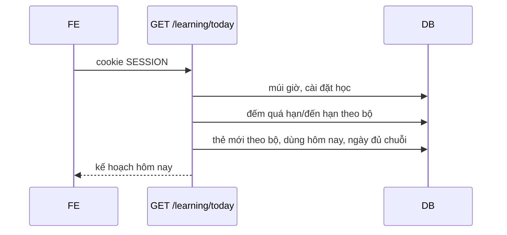

# Báo cáo bàn giao BE → FE — DOT2 Học, luyện tập, thống kê & quản trị

| Mục | Giá trị |
|---|---|
| Giai đoạn | Đợt 2 — Học, luyện tập, thống kê & quản trị (26/10 – 08/11/2026) |
| Ngày cập nhật | 19/10/2026 — B2.2 |
| Trạng thái BE | 🟡 B2.1 xong (không API). B2.2 xong theo test: người dùng chạy `StreakCalculatorTest` và `FR06TodayPlanTest` ngày 19/10 và báo không lỗi (không ghi số lượng); **chưa gọi HTTP thật**; Postman đã có request, chưa chạy. B2.3–B2.11 chưa làm |
| FE làm tương ứng | F2.1 (`roadmap/TienDoDuKien_fronend.md`), UI12 `/hom-nay` |
| Báo cáo trước | [Đợt 1](SPRINT_1_BAO_CAO_BE_BAN_GIAO_CHO_FE.md) — hợp đồng chung (lỗi `{code,message,fieldErrors,requestId}`, CSRF, phân trang, ID dạng chuỗi, cookie `SESSION`) xem ở đó |

> **Đọc nhanh:**
> - Báo cáo này mới có một API: `GET /api/v1/learning/today` (mục 5.1). Mọi thứ khác của Đợt 2 vẫn dùng MSW.
> - Hợp đồng ở mục 5.1 là **contract từ code**, test BE đã chạy nhưng chưa gọi HTTP thật nên JSON mẫu chưa phải response thật (mục 10).
> - Phần lớn số liệu bằng 0 cho đến khi B2.4 (ghi kết quả ôn) hoàn tất, vì chưa có API nào ghi `tien_do_the` và `su_dung_hoc_ngay`.

---

## 1. BE đã giao gì (đối chiếu 2 roadmap)

| BE bước | Kết quả | FE bước / UI | FE cần làm |
|---|---|---|---|
| B2.1 Bộ tính SRS thuần | ✅ `SrsCalculator` (`SM2-VN-1`), 28 test theo roadmap; không API | — | Không có việc cho FE |
| B2.2 Kế hoạch hôm nay | ✅ `GET /learning/today`, test BE đã chạy (người dùng xác nhận); chưa HTTP thật | F2.1 UI12 `/hom-nay` | Nối theo mục 5.1; ẩn khối cứu lịch ôn |

**Chưa có** (dùng MSW): tạo phiên học và ghi kết quả ôn (B2.3–B2.4), kết thúc phiên/lịch sử/tạm ngưng/đặt lại (B2.5), cứu lịch ôn và query `phut`, `giuTuMoi` (B2.6), luyện tập (B2.7–B2.8), sổ tay (B2.9), thống kê (B2.10), quản trị (B2.11).

## 2. Chạy BE

Không có dịch vụ, biến môi trường hay dữ liệu mẫu mới. Windows cần `JAVA_TOOL_OPTIONS=-Djdk.net.unixdomain.tmpdir=C:\Users\Public` khi chạy test (Netty/Redis loopback). Chạy API từ `backend/k28/` bằng `.\mvnw.cmd spring-boot:run`; sửa code rồi `.\mvnw.cmd -q -DskipTests compile` để DevTools tự khởi động lại.

## 3. Thay đổi hợp đồng chung

Không thay đổi. Không có mã lỗi mới. Điều kiện: ID trong `boThe[]` dạng chuỗi, tên field trùng tên entity/mockup (tiếng Việt không dấu).

## 4. Luồng chính



Chi tiết: [luồng B2.2](../docs/luong-backend/B2.2-ke-hoach-hom-nay.md).

## 5. API chi tiết

### 5.1 `GET /api/v1/learning/today` — kế hoạch hôm nay

| Quyền | FE bước | UI | Trang |
|---|---|---|---|
| L (đăng nhập) | F2.1 | UI12 | `/hom-nay` |

**Gửi:** không có query hay body ở B2.2 (`phut`, `giuTuMoi` thuộc B2.6).

**Nhận** (contract từ code; số liệu minh họa, **không phải response thật**)

```http
HTTP/1.1 200
Content-Type: application/json
```
```json
{
  "ngay": "2026-10-19",
  "soQuaHan": 2,
  "soDenHan": 1,
  "soTheMoiDaHoc": 0,
  "tuMoiMoiNgay": 10,
  "soMoiConLai": 2,
  "giayMoiLuot": 20,
  "uocTinhPhut": 2,
  "phutMoiNgay": 10,
  "chuoiNgay": 0,
  "homNayDaTinhChuoi": false,
  "luotToiThieuChuoi": 5,
  "daHocHomNay": { "soLuot": 0, "soPhut": 0 },
  "tongSoThe": 5,
  "boThe": [
    { "boTheId": "12", "ten": "Từ vựng văn phòng", "soCanOn": 3, "soMoi": 2 }
  ]
}
```

| Trường | Ý nghĩa |
|---|---|
| `ngay` | Ngày địa phương theo múi giờ của người dùng |
| `soQuaHan` | Lượt (hàng tiến độ) có hạn trước đầu ngày; một thẻ hai chiều có thể tính 2 |
| `soDenHan` | Lượt có hạn trong ngày, kể cả chưa tới giờ; có thể lớn hơn số thẻ vào hàng đợi lúc đó |
| `soTheMoiDaHoc`, `tuMoiMoiNgay`, `soMoiConLai` | Hạn mức từ mới (thẻ vật lý, không nhân đôi hai chiều); `soMoiConLai` không âm |
| `giayMoiLuot`, `uocTinhPhut` | Ước tính cố định 20 giây/lượt; hiển thị là "ước tính" |
| `phutMoiNgay` | Mục tiêu phút từ thiết lập học |
| `chuoiNgay`, `homNayDaTinhChuoi`, `luotToiThieuChuoi` | Ngày liên tiếp có ≥5 lượt hợp lệ; hôm nay chưa đủ thì chuỗi tính từ hôm qua |
| `daHocHomNay` | `soLuot` thật; `soPhut` là ước tính từ số lượt |
| `tongSoThe` | 0 → hiện màn hình chưa có thẻ nào |
| `boThe[]` | Mọi bộ chưa xóa của người dùng (kể cả bộ rỗng), sắp theo tên; `soCanOn` = quá hạn + đến hạn của bộ; `soMoi` không bị cắt theo hạn mức |

Không có `cuuLichOn`; FE coi là `undefined` đến hết B2.6.

**Lỗi**

| HTTP | `code` | Khi nào | FE xử lý |
|---|---|---|---|
| 401 | `UNAUTHENTICATED` | Chưa đăng nhập hoặc phiên hết hạn | Chuyển `/dang-nhap` |

**Tác dụng phụ:** lần gọi đầu có thể tạo hồ sơ học tập mặc định (10 phút, 10 từ mới/ngày) nếu người dùng chưa có.

## 6. Mã FE mẫu

- Zod schema: các field ở mục 5.1; `boThe[].boTheId` là `z.string()`, `cuuLichOn` là `.optional()`.
- Hook: `useQuery({ queryKey: ['learning','today'], queryFn: () => api('/learning/today') })`; làm mới sau khi kết thúc phiên (B2.5).
- MSW: dùng JSON minh họa ở mục 5.1 cho đến khi có response thật.

## 7. Dữ liệu mẫu / tài khoản demo

Chưa có seed cho tiến độ thẻ. Đến B2.4 mới tạo được `tien_do_the` qua API; trước đó người dùng mới luôn thấy `soQuaHan=0`, `soDenHan=0`, `chuoiNgay=0`.

## 8. Checklist FE hoàn thành Đợt 2 (phần B2.2)

- [ ] F2.1 `/hom-nay` đọc `GET /learning/today` thật, không còn MSW
- [ ] Hiển thị hai nhãn "Quá hạn" và "Đến hạn hôm nay" đúng ngữ nghĩa mục 5.1
- [ ] `tongSoThe = 0` hiện trạng thái chưa có thẻ; `soCanOn + soMoiConLai = 0` hiện "không còn thẻ nào hôm nay"
- [ ] Chuỗi ngày dùng `homNayDaTinhChuoi` và `luotToiThieuChuoi`, không hard-code số 5
- [ ] Khối cứu lịch ôn ẩn khi không có `cuuLichOn`

## 9. Sắp có ở Đợt 2 — hợp đồng dự kiến

| BE bước | Dự kiến có | API | FE bước | UI |
|---|---|---|---|---|
| B2.3 | Tạo phiên học | `POST /learning/sessions`, `GET /learning/sessions/{id}` | F2.2 | UI18, UI19 |
| B2.4 | Ghi kết quả ôn | `POST /learning/sessions/{id}/reviews` | F2.3 | UI19 |
| B2.5 | Kết thúc phiên, lịch sử | `POST .../finish`, `GET /learning/history`, `PUT /cards/{id}/progress/suspend`, `POST /cards/{id}/progress/reset` | F2.3 | UI20, UI21 |
| B2.6 | Cứu lịch ôn | Thêm `cuuLichOn` và query `phut`, `giuTuMoi` vào `/learning/today` | F2.4 | UI22 |

Hợp đồng dự kiến theo TK §13 và roadmap; chưa phải đã triển khai.

## 10. Lưu ý / giới hạn / chưa kiểm chứng

| Mục | Chi tiết |
|---|---|
| Kiểm chứng | `StreakCalculatorTest` và `FR06TodayPlanTest` (chưa commit) đã được người dùng chạy ngày 19/10/2026, báo không lỗi; không có số lượng test hay log đính kèm. Chưa HTTP thật; request Postman chưa chạy |
| Quyết định nghiệp vụ đề xuất | 20 giây/lượt (hằng); chuỗi theo ngày ≥5 lượt thay vì theo phiên (TK §15.1 chưa chốt); `daHocHomNay.soPhut` ước tính. Có thể đổi khi B2.3/B2.5 và Đợt 3 hoàn tất |
| "Đến hạn hôm nay" ≠ hàng đợi | Gồm cả thẻ hạn muộn hơn giờ hiện tại trong ngày; hàng đợi B2.3 lấy `han_on_at <= now`. FE không dùng `soDenHan` làm số thẻ chắc chắn học được ngay |
| Mockup | Đã rà 19/10: `mockups/dot2/hom-nay.html` đọc đúng tên field, hiển thị đúng và console không lỗi; `demo.js` đã bỏ `muiGio`, `laUocTinh`. Lệch còn lại của demo: 15 giây/lượt (BE 20, trang đọc `giayMoiLuot`), `soPhut` đo thật còn BE ước tính, demo không liệt kê bộ rỗng, demo có `cuuLichOn` (B2.6). `hoc.html` ghi cứng "15 giây" (B2.3) |
| Postman | Request `Kế hoạch hôm nay (B2.2 · FR-06)` đã tạo trong "VocabLearning API" › "03 Học tập", có test script; chưa chạy request. Cần đăng nhập trước bằng request thư mục 01 |
| Đổi múi giờ | Ngày cũ trong `su_dung_hoc_ngay` giữ ngày địa phương lúc ghi, không viết lại |
| Chuỗi | Chỉ xét tối đa 1000 ngày gần nhất |
| Ngoại lệ module | Truy vấn của `learning` join entity `content` (chỉ đọc); đã ghi vào conventions |

## 11. Báo lỗi cho BE

Gửi đường dẫn API + body + `requestId`; BE tra log theo `requestId`.
