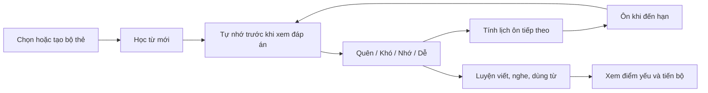
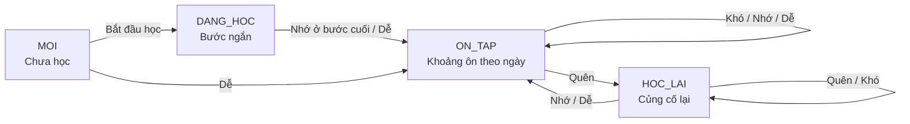
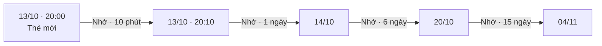
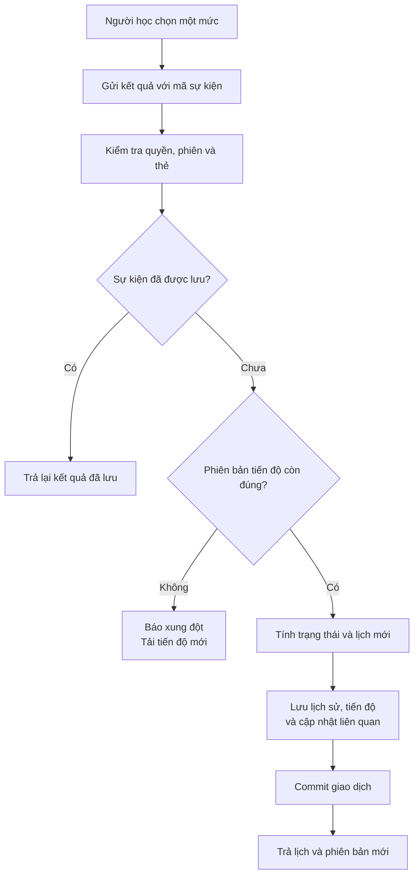

**SRS là cơ chế giúp ứng dụng quyết định: “Từ này cần xuất hiện lại khi nào?”** Mỗi lần bạn học một thẻ và chọn **Quên / Khó / Nhớ / Dễ**, hệ thống dùng kết quả đó cùng tiến độ trước đây để tính lịch ôn tiếp theo.

Trong VocabLearning, SRS là phần lõi của vòng học:



Mình đã đọc toàn bộ 22 mục của [tài liệu phân tích–thiết kế trong repository](C:/doantotnghiep/khoa_luan_tot_nghiep/docs/PHAN_TICH_THIET_KE_HE_THONG_HOC_TU_VUNG_K28.md), đề cương PDF 7 trang, và đối chiếu các phần SRS trong thiết kế dữ liệu Word, roadmap, sprint plan, tài liệu bàn giao, mockup và bộ tài liệu ở `C:/doantotnghiep/docs`.

**Có hai bộ quy tắc SRS đang khác nhau.** Phần giải thích dưới đây theo **TK §7.2 trong repository**, vì [roadmap B2.1](C:/doantotnghiep/khoa_luan_tot_nghiep/roadmap/TienDoDuKien_backend.md:284) và TC-06/TC-07 viện dẫn trực tiếp bảng này.

| Điểm khác nhau | TK trong repository | Bộ tài liệu ngoài repository |
|---|---|---|
| Quên khi đang ôn | Học lại sau **10 phút** | Học lại sau **1 phút** |
| EF khi Quên, trước khi áp dụng mức sàn | Giảm **0,54** | Giảm **0,20** |
| EF khi Khó | Giảm **0,14** | Giảm **0,15** |
| Hoàn tất học lại bằng Nhớ | Ôn sau **1 ngày** | Dùng khoảng **50% lịch cũ** |
| Khoảng ôn theo ngày | Ngày lịch địa phương và giờ ôn quy định | Cộng số ngày × 24 giờ |

Đây là khác biệt nghiệp vụ, không chỉ khác cách viết. Có thể xem phiên bản thứ hai tại [thiết kế hệ thống §9.1](C:/doantotnghiep/docs/THIET_KE_HE_THONG_HOC_TU_VUNG.md:1408). Trước khi lập trình, cần thống nhất một bảng quy tắc và đồng bộ tài liệu, kiểm thử theo bảng đó.

**Hiện trạng:** backend chưa có bộ tính và các API SRS; B2.1–B2.6 chưa hoàn tất. Mockup có hàm mô phỏng, nhưng không phải bằng chứng backend đã triển khai.

---

**1. “Lặp lại ngắt quãng” nghĩa là gì?**

“Lặp lại” là gặp lại kiến thức đã học. “Ngắt quãng” là những lần gặp lại được phân bố theo thời gian.

Ví dụ với từ **receipt — biên lai**:

| Cách học | Lịch minh họa |
|---|---|
| Học dồn | Đọc từ đó 10 lần trong một buổi |
| Học có khoảng cách | Học hôm nay, ôn ngày mai, rồi ôn sau vài ngày |
| SRS cá nhân hóa | Nếu nhớ tốt thì giãn lịch; nếu quên thì đưa về học lại sớm |

Nghiên cứu về thực hành phân bố cho thấy khoảng cách giữa những lần học ảnh hưởng đến khả năng ghi nhớ; khoảng cách phù hợp còn phụ thuộc thời gian cần giữ kiến thức. Không có một lịch cố định tối ưu cho mọi người và mọi từ. [Nghiên cứu tổng hợp của Cepeda và cộng sự](https://pubmed.ncbi.nlm.nih.gov/16719566/).

Trong ứng dụng, điều này dẫn đến một cách tổ chức cụ thể:

> Bạn có thể ôn `receipt` hôm nay, nhưng chưa cần ôn `hello`, vì lịch của từng thẻ khác nhau.

SRS không đo trực tiếp trí nhớ trong não. Nó **ước lượng lịch phù hợp từ lịch sử phản hồi của bạn**.

---

**2. Vì sao phải tự nhớ trước khi lật thẻ?**

Một lượt học nên diễn ra như sau:

1. Nhìn mặt trước: `receipt`.
2. Tự nghĩ nghĩa hoặc nói ra: “biên lai”.
3. Lật thẻ để kiểm tra.
4. Đánh giá khả năng nhớ **trước lúc xem đáp án**.

Việc chủ động gọi lại kiến thức từ trí nhớ thường được gọi là **active recall — nhớ lại chủ động**. Nghiên cứu của Roediger và Karpicke cho thấy thực hành truy xuất có thể cải thiện khả năng giữ kiến thức dài hạn. [Test-Enhanced Learning](https://www.psychologicalscience.org/journals/psychological-science/j.1467-9280.2006.01693.x/).

Ví dụ:

- Bạn không nhớ nghĩa, lật thẻ thấy “biên lai” rồi nhận ra từ quen → chọn **Quên**.
- Bạn nhớ đúng nhưng phải suy nghĩ khá lâu → chọn **Khó**.
- Bạn nhớ đúng tương đối nhanh → chọn **Nhớ**.
- Bạn biết ngay, rất chắc chắn → chọn **Dễ**.

**“Nhìn đáp án rồi thấy quen” khác với “tự nhớ được đáp án”.** Nếu luôn chọn Dễ sau khi nhìn đáp án, lịch sẽ bị kéo xa hơn khả năng nhớ thực tế.

---

**3. SRS, SM-2 và AI khác nhau thế nào?**

| Khái niệm | Vai trò |
|---|---|
| **SRS** | Hệ thống tổ chức việc ôn tập có khoảng cách |
| **SM-2** | Một thuật toán tính khoảng ôn và hệ số dễ nhớ |
| **Biến thể SM-2 của dự án** | Điều chỉnh SM-2 để có bốn nút đánh giá, bước học phút và bước học lại |
| **AI** | Tạo thẻ nháp, giải thích, mẹo nhớ và phản hồi câu viết |
| **FSRS** | Một hướng lập lịch khác, mô hình hóa độ khó, độ ổn định và khả năng nhớ |

SM-2 nguyên bản sử dụng điểm chất lượng từ 0–5, EF ban đầu 2,5, các khoảng ôn cơ bản 1 ngày, 6 ngày rồi tăng theo EF. Tài liệu gốc yêu cầu làm tròn khoảng lẻ lên số nguyên. [Thuật toán SM-2 của tác giả](https://super-memory.org/archive/english/ol/sm2.htm).

Dự án thêm bước học ngắn và quy tắc riêng cho Quên/Khó/Nhớ/Dễ. Vì vậy, trong báo cáo nên gọi đúng là:

> **“Biến thể thuật toán SM-2 có bước học mới và học lại.”**

FSRS sử dụng các đại lượng Difficulty, Stability và Retrievability để mô hình hóa trí nhớ. Dự án hiện mô tả SM-2 biến thể, chưa mô tả triển khai FSRS. [Tài liệu của dự án FSRS](https://github.com/open-spaced-repetition/awesome-fsrs/wiki/The-Algorithm).

**AI không quyết định lịch ôn trong thiết kế này.** Backend tính lịch bằng quy tắc xác định, để cùng đầu vào luôn cho cùng kết quả và có thể kiểm thử.

---

**4. Hệ thống theo dõi tiến độ của cái gì?**

Đơn vị theo dõi là:

```text
Một người học + một thẻ + một chiều học
```

Ví dụ cùng một thẻ `receipt`:

| Người học | Chiều | Nội dung cần nhớ | Lịch có thể khác nhau |
|---|---|---|---|
| Pho | Anh → Việt | `receipt` → “biên lai” | Sau 15 ngày |
| Pho | Việt → Anh | “biên lai” → `receipt` | Sau 10 phút |
| Một người khác | Anh → Việt | `receipt` → “biên lai” | Sau 1 ngày |

Bạn có thể nhận ra nghĩa khi nhìn tiếng Anh, nhưng chưa tự viết được từ tiếng Anh khi nhìn nghĩa tiếng Việt. Vì thế, **hai chiều cần hai tiến độ riêng**.

Theo [TK §7.1](C:/doantotnghiep/khoa_luan_tot_nghiep/docs/PHAN_TICH_THIET_KE_HE_THONG_HOC_TU_VUNG_K28.md:271), khóa duy nhất của tiến độ là:

```text
(nguoi_dung_id, the_id, chieu_hoc)
```

Hai chiều được ký hiệu:

- `EN_VI`: Anh → Việt.
- `VI_EN`: Việt → Anh.

---

**5. Các trạng thái của một thẻ**

| Trạng thái | Ý nghĩa dễ hiểu |
|---|---|
| `MOI` | Chiều học này chưa được học |
| `DANG_HOC` | Đang ghi nhớ ban đầu, lịch thường tính bằng phút |
| `ON_TAP` | Đã qua bước học đầu, lịch tính bằng ngày |
| `HOC_LAI` | Đang ôn nhưng quên, cần củng cố lại |
| `TAM_NGUNG` | Tạm loại khỏi hàng đợi học |

Luồng chính:



**“Đến hạn” và “quá hạn” không phải hai trạng thái lưu riêng.** Chúng được tính từ thời điểm cần ôn `han_on_at`.

Ví dụ thẻ vẫn có trạng thái `ON_TAP`:

- Hẹn ôn 20:00, hiện tại 19:00 → chưa đến hạn.
- Hiện tại 20:00 → đến hạn.
- Hiện tại 21:00 → đã quá thời điểm hẹn.

Một điểm cần thống nhất thêm: TK gọi quá hạn khi `han_on_at < now`, còn mockup bảng hôm nay chia nhóm quá hạn theo **trước đầu ngày**. Hai cách phân nhóm này cần có tên rõ ràng khi triển khai.

---

**6. Những con số dùng để tính lịch**

| Đại lượng | Ý nghĩa | Ví dụ |
|---|---|---|
| `EF` | Hệ số dễ nhớ của tiến độ này | 2,5 |
| `I` | Khoảng ôn cũ, tính bằng ngày | 6 ngày |
| `q` | Điểm chất lượng ứng với nút đã chọn | Nhớ → 4 |
| `buoc_hoc` | Bước ghi nhớ ban đầu | 0 hoặc 1 |
| `chuoi_thanh_cong` | Số lượt liên tiếp thành công theo quy tắc | 2 |
| `so_lan_quen` | Số lần đang ôn bị chuyển sang học lại | 3 |
| `han_on_at` | Thời điểm cần xuất hiện lại | Một timestamp cụ thể |
| `version` | Phiên bản dữ liệu để chống ghi đè | 7 |

**EF là hệ số nhân, không phải phần trăm trí nhớ.**

- EF = 2,5 không có nghĩa bạn nhớ 250%.
- Khi nhánh Nhớ dùng phép nhân, khoảng cũ 6 ngày có thể tăng thành `6 × 2,5 = 15 ngày`.
- EF thấp hơn làm lịch tăng chậm hơn trong những nhánh sử dụng EF.

Theo TK:

- EF khởi tạo: **2,5**.
- EF tối thiểu: **1,3**.
- Khoảng ôn tối đa đề xuất: **365 ngày**.

EF không bị giới hạn tối đa ở 2,5 trong công thức này: chọn Dễ khi đang ôn có thể làm EF tăng lên 2,6.

Trường `do_kho` của nội dung thẻ cũng khác EF: một trường mô tả nội dung, còn EF thuộc tiến độ cá nhân của từng người và từng chiều.

---

**7. Công thức cập nhật EF**

Bốn nút được ánh xạ như sau:

| Nút | `q` |
|---|---:|
| Quên | 1 |
| Khó | 3 |
| Nhớ | 4 |
| Dễ | 5 |

**Phím tắt 1–4 là vị trí nút, không phải giá trị q.** Ví dụ phím 3 chọn Nhớ, nhưng q của Nhớ bằng 4.

Theo [TK §7.2](C:/doantotnghiep/khoa_luan_tot_nghiep/docs/PHAN_TICH_THIET_KE_HE_THONG_HOC_TU_VUNG_K28.md:285):

```text
EF_mới = max(
    1,3;
    EF_cũ + 0,1 − (5 − q) × [0,08 + (5 − q) × 0,02]
)
```

Trong đó `max` nghĩa là lấy giá trị lớn hơn, để EF không xuống dưới 1,3.

Thay từng q vào công thức:

| Đánh giá | Thay đổi EF trước khi áp dụng mức sàn | Nếu EF cũ = 2,5 |
|---|---:|---:|
| Quên | −0,54 | 1,96 |
| Khó | −0,14 | 2,36 |
| Nhớ | 0 | 2,50 |
| Dễ | +0,10 | 2,60 |

Ví dụ chọn Quên:

```text
q = 1
5 − q = 4

EF_mới
= max(1,3; 2,5 + 0,1 − 4 × [0,08 + 4 × 0,02])
= max(1,3; 2,5 + 0,1 − 0,64)
= 1,96
```

Nếu EF cũ chỉ là 1,5:

```text
EF_mới = max(1,3; 1,5 − 0,54)
        = 1,3
```

**Công thức EF chỉ chạy khi trạng thái trước lượt trả lời là `ON_TAP`.** Các lượt học phút trong `DANG_HOC` hoặc `HOC_LAI` không tiếp tục làm giảm EF.

---

**8. Cách tính lịch trong từng giai đoạn**

**Khi học mới hoặc đang ghi nhớ ban đầu:**

| Trạng thái trước khi chọn | Quên | Khó | Nhớ | Dễ |
|---|---|---|---|---|
| `MOI` | 1 phút, bước 0 | 5 phút, bước 0 | 10 phút, bước 1 | Sang ôn, 4 ngày |
| `DANG_HOC`, bước 0 | 1 phút, bước 0 | 5 phút, giữ bước | 10 phút, bước 1 | Sang ôn, 4 ngày |
| `DANG_HOC`, bước 1 | 1 phút, về bước 0 | 10 phút, giữ bước | Sang ôn, 1 ngày | Sang ôn, 4 ngày |

Khi sang `ON_TAP` từ giai đoạn học đầu, chuỗi thành công được đặt bằng 1.

**Khi đang ôn — `ON_TAP`:**

Đầu tiên tính EF mới, sau đó tính lịch:

| Nút | Kết quả |
|---|---|
| **Quên** | Chuyển `HOC_LAI`, hẹn 10 phút; số lần quên +1; chuỗi thành công về 0 |
| **Khó** | `I_mới = max(I + 1; round(I × 1,2))` |
| **Nhớ** | Nếu chuỗi cũ = 1: hẹn 6 ngày. Nếu chuỗi cũ ≥2: `I_mới = max(I + 1; round(I × EF_mới))` |
| **Dễ** | `I_mới = max(I + 1; round(I × EF_mới × 1,3))` |

Khó/Nhớ/Dễ đều tăng chuỗi thành công thêm 1. Khoảng ngày sau tính toán được giới hạn tối đa 365.

Các ký hiệu:

- `round`: làm tròn về số nguyên gần nhất.
- `I + 1`: bảo đảm khoảng mới tăng ít nhất một ngày, trước khi áp dụng trần.
- `× 1,2`: hệ số tăng khoảng của nhánh Khó.
- `× 1,3`: hệ số bổ sung của nhánh Dễ.

**Khi học lại — `HOC_LAI`:**

| Nút | Kết quả |
|---|---|
| Quên | Giữ học lại, hẹn 1 phút |
| Khó | Giữ học lại, hẹn 10 phút |
| Nhớ | Trở lại ôn sau 1 ngày, chuỗi thành công = 1 |
| Dễ | Trở lại ôn sau 2 ngày, chuỗi thành công = 1 |

Tài liệu chưa quy định rõ xử lý trường hợp làm tròn đúng `.5`; các ví dụ bên dưới dùng giả định **0,5 làm tròn lên**. Đây là giả định minh họa, chưa phải quyết định triển khai.

---

**9. Ví dụ đầy đủ: học từ `receipt`**

Giả sử:

- Học chiều Anh → Việt.
- EF ban đầu = 2,5.
- Bắt đầu ngày **13/10/2026 lúc 20:00**.
- Với lịch theo ngày, giả định giờ đến hạn đã được quy định là **20:00**.

Bạn luôn chọn **Nhớ**:

| Lượt | Thời điểm trả lời | Trạng thái trước | Cách tính | Hẹn tiếp theo |
|---|---|---|---|---|
| 1 | 13/10, 20:00 | Mới | Nhớ → bước 1, 10 phút | 13/10, 20:10 |
| 2 | 13/10, 20:10 | Đang học, bước 1 | Nhớ → sang ôn, 1 ngày | 14/10, 20:00 |
| 3 | 14/10, 20:00 | Ôn, chuỗi = 1 | Nhớ → mốc 6 ngày | 20/10, 20:00 |
| 4 | 20/10, 20:00 | Ôn, chuỗi = 2 | `6 × 2,5 = 15 ngày` | 04/11, 20:00 |



**10 phút → 1 ngày → 6 ngày → 15 ngày là khoảng chờ giữa các lượt**, không phải tất cả đều tính từ ngày bắt đầu.

Nếu tiếp tục chọn Nhớ:

```text
Khoảng cũ = 15 ngày
EF mới = 2,5

Khoảng mới = max(16; round(15 × 2,5))
           = max(16; round(37,5))
           = 38 ngày
```

Một lần bấm khác đi có thể làm toàn bộ lịch tiếp theo khác đi. SRS không áp dụng chuỗi 1–6–15 cho mọi trường hợp.

---

**10. Cùng một tiến độ nhưng chọn bốn nút sẽ khác thế nào?**

Giả sử trước lượt ôn:

```text
Trạng thái: ON_TAP
Khoảng cũ I: 6 ngày
EF cũ: 2,5
Chuỗi thành công cũ: 2
```

Mỗi hàng dưới đây là **một lựa chọn độc lập từ cùng trạng thái ban đầu**:

| Chọn | EF mới | Phép tính | Lịch mới |
|---|---:|---|---|
| Quên | 1,96 | Chuyển học lại | 10 phút |
| Khó | 2,36 | `max(7; round(6 × 1,2))` | 7 ngày |
| Nhớ | 2,50 | `max(7; round(6 × 2,5))` | 15 ngày |
| Dễ | 2,60 | `max(7; round(6 × 2,6 × 1,3))` | 20 ngày |

Hai chi tiết dễ nhầm:

- Nhánh **Dễ dùng EF mới 2,6**, theo bảng TK đang giải thích.
- Nhánh **Khó tính khoảng bằng ×1,2**, mặc dù EF cũng giảm. EF thấp hơn sẽ ảnh hưởng các lượt tiếp theo dùng EF.

**Ví dụ quên rồi học lại:**

| Lượt | Chọn | Kết quả |
|---|---|---|
| Đang ôn, EF 2,5 | Quên | EF thành 1,96; chuyển học lại sau 10 phút; số lần quên +1 |
| Trong học lại | Khó | Hẹn thêm 10 phút; EF vẫn 1,96 |
| Vẫn học lại | Khó | Hẹn thêm 10 phút; EF vẫn 1,96 |
| Vẫn học lại | Nhớ | Trở lại ôn sau 1 ngày; chuỗi thành công = 1 |
| Lần ôn tiếp theo | Nhớ | Hẹn 6 ngày; EF vẫn 1,96 |
| Sau đó | Nhớ | `round(6 × 1,96) = 12 ngày` |

Bạn cần củng cố từ này thường xuyên hơn trước. Nhưng ba lượt học lại không đồng nghĩa số lần quên tăng ba lần: theo bảng TK, việc tăng xảy ra khi **từ `ON_TAP` chuyển sang `HOC_LAI`**.

---

**11. “Sau 1 ngày” và “sau 24 giờ” khác nhau**

Đây là điểm quan trọng khi lập trình.

Giả sử bạn hoàn tất một bước lúc **23:50 ngày 13/10**:

| Cách tính | Kết quả |
|---|---|
| Cộng 24 giờ | 23:50 ngày 14/10 |
| Ngày lịch + giờ ôn giả định 20:00 | 20:00 ngày 14/10 |

Theo [TK §7.3](C:/doantotnghiep/khoa_luan_tot_nghiep/docs/PHAN_TICH_THIET_KE_HE_THONG_HOC_TU_VUNG_K28.md:309):

- Bước phút: tính từ thời điểm máy chủ nhận kết quả.
- Bước ngày: tính theo ngày lịch, múi giờ của phiên và giờ ôn đã quy định.
- Lưu thời điểm dưới dạng UTC.
- Hiển thị và tính ngày mục tiêu theo múi giờ người học.

Ví dụ:

```text
20:00 tại Việt Nam
= 13:00 UTC
```

**Giờ nhắc học và giờ đến hạn cũng là hai khái niệm khác nhau.** Tài liệu chưa đủ rõ để mặc nhiên lấy giờ nhắc làm giờ đến hạn.

Vì vậy, bộ tính thuần có thể quyết định “10 phút” hoặc “6 ngày”; phần xử lý thời gian phải có đủ múi giờ và quy tắc giờ ôn để biến khoảng đó thành timestamp. Đầu vào chỉ có `Instant now` chưa thể tự xác định đầy đủ ngày lịch địa phương.

---

**12. Ứng dụng chọn thẻ nào cho hôm nay?**

SRS tính lịch từng tiến độ. **Hàng đợi phiên học** chọn những tiến độ phù hợp để đưa ra trước mặt bạn.

Theo thiết kế, thứ tự ưu tiên là:

1. Các bước học lại đến hạn; các bước học ngắn đến hạn cũng cần được phục vụ.
2. Thẻ ôn quá hạn hoặc đến hạn.
3. Thẻ mới, trong hạn mức.

Không đưa thẻ tạm ngưng, đã xóa hoặc không còn quyền truy cập vào hàng đợi.

Ví dụ bạn đặt mục tiêu **10 từ mới/ngày**:

- Học `receipt` chiều Anh → Việt lần đầu: dùng một suất từ mới.
- Học tiếp chiều Việt → Anh: có tiến độ riêng, nhưng không dùng thêm một suất cho cùng thẻ vật lý.
- Hết 10 suất từ mới: vẫn được ôn các thẻ cũ đến hạn.

**Số thẻ và số lượt học cũng khác nhau.**

Một thẻ xuất hiện ba lần trong bước học ngắn:

```text
Số thẻ khác nhau: 1
Số lượt trả lời: 3
```

Không nên hiển thị thành “đã học ba từ mới”.

**Ước tính phiên theo thời gian**

Một công thức minh họa đơn giản:

```text
Số lượt dự kiến
= floor(quỹ thời gian tính bằng giây / thời gian trung bình mỗi lượt)
```

Giả sử bạn có 10 phút và một lượt trung bình mất 20 giây:

```text
floor(600 / 20) = 30 lượt
```

Đó là **ước tính**, không bảo đảm học được 30 từ khác nhau: một số thẻ cần lặp lại, từ mới có thể mất nhiều thời gian hơn.

TK yêu cầu dùng tốc độ gần đây của người học khi có dữ liệu. Mockup hiện dùng giá trị cố định **15 giây/lượt**, nên con số demo không phải phép đo thực tế của bạn.

**Cứu lịch ôn**

Giả sử còn 120 lượt cần xử lý và khả năng dự kiến là 30 lượt/ngày:

```text
ceil(120 / 30) = 4 ngày
```

Ứng dụng có thể giảm từ mới và chia khối lượng ôn. Ước tính phải điều chỉnh khi có thêm lượt đến hạn hoặc các bước học lại.

**Không được tự đổi ngày đến hạn của 120 thẻ để làm mất nợ ôn trên thống kê.** Việc chia kế hoạch khác với sửa lịch gốc.

---

**13. Backend xử lý một lần bấm như thế nào?**

Một lượt trả lời không chỉ chạy công thức. Nó còn phải được lưu đúng một lần.



Hai cơ chế bảo vệ khác nhau:

| Cơ chế | Giải quyết vấn đề |
|---|---|
| `clientEventId` | Cùng một lượt bị gửi lại vì mất mạng |
| `expectedVersion` | Hai tab cùng sửa từ một tiến độ cũ |

Ví dụ mất mạng:

1. Bạn chọn Nhớ.
2. Máy chủ đã lưu, nhưng phản hồi bị mất.
3. Trình duyệt gửi lại **cùng mã sự kiện**.
4. Máy chủ trả kết quả cũ; không tăng lịch, lượt học hoặc thưởng lần nữa.

Ví dụ hai tab:

- Tab A và B đều đang thấy version 7.
- A lưu thành công, tiến độ sang version 8.
- B gửi một sự kiện khác nhưng vẫn dùng version 7.
- B nhận xung đột và phải tải trạng thái mới.

Theo thiết kế dữ liệu, các bảng có nhiệm vụ riêng:

| Bảng | Lưu gì? |
|---|---|
| `the_tu_vung` | Nội dung từ, nghĩa, ví dụ, IPA |
| `tien_do_the` | Trạng thái và lịch hiện tại theo người/thẻ/chiều |
| `phien_hoc` | Phiên học, thời gian và múi giờ |
| `phien_hoc_the` | Hàng đợi được cấp cho phiên |
| `lich_su_on` | Từng lượt trả lời, trạng thái trước/sau, phiên bản thuật toán |
| `su_dung_hoc_ngay` | Số thẻ mới và lượt hợp lệ theo ngày địa phương |

Tách như vậy giúp trả lời được: **“Tại sao từ này được hẹn ôn sau 12 ngày?”**, thay vì chỉ biết lịch hiện tại mà không biết nó hình thành thế nào.

---

**14. SRS liên quan thế nào đến luyện tập, AI, thống kê và điểm thưởng?**

| Thành phần | Quan hệ với SRS |
|---|---|
| Luyện chính tả | Bổ sung bằng chứng bạn có viết được từ hay không |
| Nghe viết | Kiểm tra khả năng nghe và viết |
| Viết câu | Kiểm tra khả năng dùng từ trong ngữ cảnh |
| Phát âm | Lưu kết quả dịch vụ đánh giá riêng |
| AI | Tạo nội dung và hỗ trợ những từ khó |
| Thống kê | Tổng hợp từ các sự kiện học hợp lệ |
| Điểm thưởng | Khuyến khích học, có chống trùng và giới hạn |

Ví dụ với `receipt`:

- Bạn nhận nghĩa đúng.
- Bạn viết thành `reciept`.
- Bạn chưa nghe ra từ trong câu.

Hệ thống có thể ghi nhận:

```text
Nhận nghĩa: có bằng chứng nhớ được
Chính tả: cần luyện thêm
Nghe: cần luyện thêm
```

**Một lịch ôn dài không đủ chứng minh bạn đã làm chủ mọi kỹ năng của từ.** EF cũng không phải điểm TOEIC hoặc trình độ CEFR.

Theo TK §6.6, làm sai một bài viết **không tự sửa lịch SRS nhận biết**, trừ khi có quy tắc liên kết được quy định riêng. Tuy nhiên, lỗi đó có thể tạo gợi ý:

> “Luyện viết ‘receipt’ vì bạn viết sai 3 trong 5 lượt gần đây.”

Điểm thưởng và chuỗi ngày cũng cần phân biệt:

| Chỉ số | Ý nghĩa |
|---|---|
| `chuoi_thanh_cong` | Chuỗi trả lời thành công của một tiến độ |
| `so_lan_quen` | Số lần tiến độ ôn chuyển sang học lại |
| Chuỗi ngày | Số ngày liên tiếp đáp ứng điều kiện học |
| Điểm kinh nghiệm | Phần thưởng từ sự kiện hợp lệ |

TK đề xuất một phiên có tối thiểu 5 lượt hợp lệ để tính ngày học, và một thẻ/chiều chỉ có một lượt thưởng SRS chính trong ngày. Đây vẫn là **quy tắc đề xuất cần thống nhất**, không phải số liệu đã kiểm chứng.

---

**15. Những điều cần kiểm chứng khi triển khai**

| Kiểm thử | Điều cần chứng minh |
|---|---|
| **TC-05** | Học Anh → Việt không làm đổi tiến độ Việt → Anh |
| **TC-06** | Chuỗi Nhớ tạo đúng 10 phút → 1 ngày → 6 ngày → 15 ngày |
| **TC-07** | Quên/học lại cập nhật đúng trạng thái, EF và số lần quên |
| **TC-08** | Gửi lại hoặc dùng hai tab không tạo cập nhật, lịch sử, thưởng trùng |
| **TC-09** | Qua nửa đêm, đổi múi giờ, học hai chiều không làm sai hạn mức |
| **TC-10** | Cứu lịch ôn chia khối lượng nhưng giữ ngày đến hạn gốc |

Các trường hợp biên cần kiểm tra thêm:

- EF chạm mức sàn 1,3.
- Khoảng ôn chạm trần 365 ngày.
- Phép tính ra `.5`.
- Học ngay trước nửa đêm.
- Kết thúc phiên trước khi bước 10 phút đến hạn.
- Thẻ bị xóa hoặc tạm ngưng giữa phiên.
- AI lỗi nhưng các chức năng học nội bộ vẫn hoạt động.

Với khóa luận, cần phân biệt hai loại bằng chứng:

- **Thuật toán chạy đúng:** kết quả khớp bảng quy tắc, thời gian và dữ liệu được lưu chính xác.
- **Người học nhớ tốt hơn:** cần đánh giá trên người học, với cách đo và khoảng thời gian theo dõi phù hợp.

Các mốc **10 phút, 1 ngày, 6 ngày, 15 ngày** là quy tắc của biến thể đang thiết kế; không nên trình bày chúng như những thời điểm được chứng minh tối ưu cho mọi người.

Đề cương gốc cũng xác định giá trị mới nằm ở cách kết hợp lịch ôn, luyện nhiều kỹ năng, gợi ý có minh chứng và hỗ trợ AI trong sản phẩm:

:codex-file-citation{path="C:/doantotnghiep/khoa_luan_tot_nghiep/docs/DE_CUONG_CHI_TIET_HOC_TU_VUNG_K28_Sưa_IN.pdf" purpose="source"}