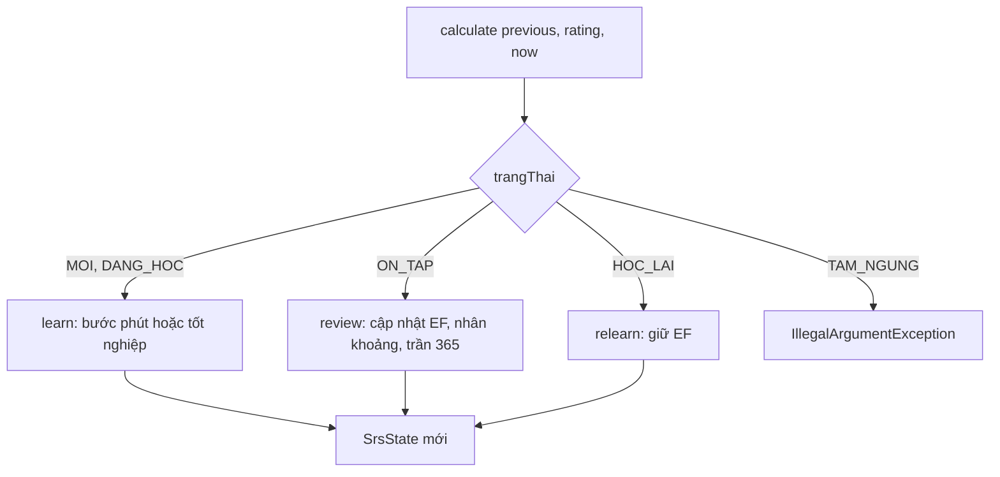

# B2.1 — Bộ tính SRS thuần

FR-06, TC-06, TC-07. Không có API; B2.3–B2.5 gọi bộ tính này. Bảng gốc: TK §7.2.

## Thành phần

| Thành phần | Vai trò |
|---|---|
| `V8__learning.sql` | `tien_do_the`, `phien_hoc`, `phien_hoc_the`, `lich_su_on`, `su_dung_hoc_ngay`; khóa `(nguoi_dung_id, the_id, chieu_hoc)`, CHECK trạng thái/EF/khoảng |
| `SrsState` | Bản chụp tiến độ bất biến (record); hằng `INITIAL_EF=2.50`, `MIN_EF=1.30`, `MAX_INTERVAL_DAYS=365`; ràng buộc theo từng trạng thái |
| `SrsCalculator` | Hàm thuần `calculate(previous, rating, now)`; không Spring, không đọc đồng hồ, không sửa input; `VERSION = "SM2-VN-1"` |

## Luồng

Người gọi (B2.4) lưu `SrsState` mới vào `tien_do_the` và ghi `lich_su_on` cùng `VERSION`.

## Quy tắc

- Mức → q: Quên 1, Khó 3, Nhớ 4, Dễ 5.
- EF chỉ đổi ở `ON_TAP`: `EF_new = max(1.3, EF + 0.1 − (5−q)(0.08 + (5−q)·0.02))`; EF khởi tạo 2.50, sàn 1.30, không trần.
- Bước phút tính từ `now`; bước ngày tính `now + N×24 giờ`.
- Khoảng ôn tối đa 365 ngày. Quên ở `ON_TAP` → `HOC_LAI`, sau 10 phút, `soLanQuen` +1, chuỗi thành công về 0.
- `TAM_NGUNG` bị từ chối.

## Quy ước đề xuất (chưa duyệt như quy tắc cố định)

| Chủ đề | Lựa chọn hiện tại | Ghi chú |
|---|---|---|
| Làm tròn `round` | HALF_UP, qua một hàm `grow` | Đổi thì nâng `VERSION` |
| Bước ngày | `now + N×24h`, qua một hàm `afterDays` | Chưa dùng ngày lịch/giờ ôn của TK §7.3; xét lại ở B2.2–B2.4 |

## Kiểm chứng

`FR06SrsCalculatorTest` gồm 28 test: TC-06 (mới → 10 phút → 1 → 6 → 15 ngày), TC-07 (quên, học lại, EF, bộ đếm), sàn EF, trần 365, các bảng học/học lại và đầu vào không hợp lệ. Kết quả ghi trong roadmap B2.1.

## Giới hạn

- `TAM_NGUNG` chưa có cột nhớ trạng thái trước khi tạm ngưng; quyết định ở B2.5.
- Chưa có replay `clientEventId`, `expectedVersion`, hạn mức từ mới, thưởng: thuộc B2.3–B2.4.

Xem [roadmap](../../roadmap/TienDoDuKien_backend.md) và [TK §7.2](../PHAN_TICH_THIET_KE_HE_THONG_HOC_TU_VUNG_K28.md).
