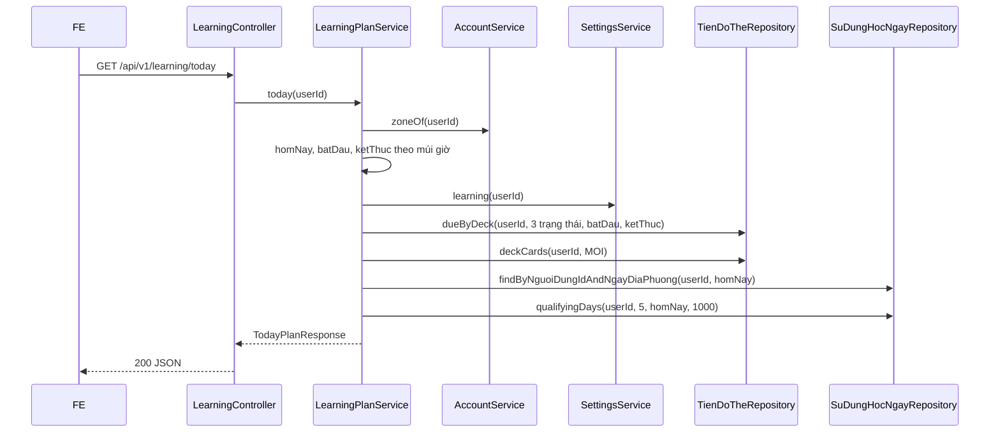

# B2.2 — Kế hoạch hôm nay

FR-02, FR-06, TC-09 · Sprint S5 · UI12 `/hom-nay` · FE F2.1. API: `GET /api/v1/learning/today`. Chỉ đọc, không ghi dữ liệu.

## Phạm vi và quyền

| Mục | Giá trị |
|---|---|
| Endpoint | `GET /api/v1/learning/today` (không có query ở B2.2; `phut`, `giuTuMoi` thuộc B2.6) |
| Quyền | Phải đăng nhập (`anyRequest().authenticated()`); chưa đăng nhập → 401. GET nên không cần CSRF |
| Đầu vào từ client | Không có. `userId` lấy từ phiên (`CurrentUser`), múi giờ lấy từ `nguoi_dung.mui_gio` |
| Migration | Không có; dùng bảng của `V8__learning.sql` |

## Thành phần

| Thành phần | Vai trò |
|---|---|
| `LearningController` | `GET /learning/today`, gọi `LearningPlanService.today` |
| `LearningPlanService` | Tính khoảng ngày theo múi giờ, gộp kết quả hai truy vấn, hạn mức từ mới, ước tính phút, chuỗi ngày. Hằng: `GIAY_MOI_LUOT=20`, `LUOT_TOI_THIEU_CHUOI=5`, `SO_NGAY_TOI_DA=1000` |
| `StreakCalculator` | Hàm thuần đếm ngày liên tiếp; không Spring |
| `TienDoThe`, `SuDungHocNgay` | Entity chỉ-đọc ở bước này (map phần cột cần dùng); B2.4 mở rộng |
| `TienDoTheRepository` | `dueByDeck` (quá hạn/đến hạn theo bộ), `deckCards` (tổng thẻ và thẻ mới theo bộ) |
| `SuDungHocNgayRepository` | Hàng của hôm nay; `qualifyingDays` (các ngày đủ lượt, mới nhất trước) |
| `AccountService.zoneOf` | Trả `ZoneId` của người dùng; learning không gọi `NguoiDungRepository` |
| `SettingsService.learning` | `phutMoiNgay`, `tuMoiMoiNgay` (tạo hồ sơ mặc định nếu chưa có) |

## Luồng

Nhánh lỗi: chưa đăng nhập → 401 từ bộ lọc bảo mật; người dùng không tồn tại → 401 `UNAUTHENTICATED` từ `AccountService.zoneOf`. Không có nhánh 404/409/422 ở bước này.

## Quy tắc

1. **Ngày địa phương:** `homNay = LocalDate.ofInstant(clock.instant(), zone)`; `batDau = homNay.atStartOfDay(zone)`; `ketThuc = (homNay+1).atStartOfDay(zone)`. Không dùng `+24h` để xử lý ngày chuyển giờ mùa hè. Khoảng nửa mở `[batDau, ketThuc)`.
2. **Phân loại** (theo `han_on_at`, không có cột trạng thái riêng): quá hạn `< batDau`; đến hạn hôm nay `batDau <= han < ketThuc`; sau `ketThuc` không đếm.
3. **Trạng thái tính:** `DANG_HOC`, `ON_TAP`, `HOC_LAI`. Loại `MOI`, `TAM_NGUNG`, thẻ có `xoa_at`, bộ có `xoa_at`, bộ không thuộc `chu_so_huu_id` của người dùng. Một thẻ hai chiều đến hạn tính 2 lượt (đếm theo hàng tiến độ).
4. **Thẻ mới:** thẻ chưa xóa của bộ chưa xóa của người dùng mà không có hàng `tien_do_the` nào của người dùng với `trang_thai <> 'MOI'`. Hàng `MOI` có thể tồn tại mà thẻ vẫn là mới. Thẻ `TAM_NGUNG` có hàng nên không phải thẻ mới.
5. **Hạn mức từ mới (TK §7.3):** `soMoiConLai = min(max(0, tuMoiMoiNgay − so_the_moi hôm nay), số thẻ mới khả dụng)`. `so_the_moi` đếm thẻ vật lý, nên không nhân đôi hai chiều; hết suất mới không giảm `soQuaHan`/`soDenHan`.
6. **Ước tính:** `giayMoiLuot = 20` (hằng, là ước tính); `uocTinhPhut = ceil((soQuaHan + soDenHan + soMoiConLai) × 20 / 60)`; `daHocHomNay.soPhut = ceil(soLuot × 20 / 60)` (suy ra từ lượt, không đo thời gian thật).
7. **Chuỗi ngày:** ngày có `so_luot_hop_le >= 5` (theo ngày, không theo phiên), tối đa 1000 ngày gần nhất. Hôm nay chưa đủ thì tính từ hôm qua; chuỗi chỉ đứt khi hôm qua cũng thiếu. `homNayDaTinhChuoi` đúng khi hôm nay đã đủ.
8. **Danh sách bộ:** mọi bộ chưa xóa của người dùng (kể cả bộ rỗng), sắp theo `ten`; `soCanOn = quá hạn + đến hạn` của bộ, `soMoi` không bị cắt theo hạn mức.

## Hợp đồng response (contract từ code)

| Field | Kiểu | Nguồn |
|---|---|---|
| `ngay` | `yyyy-MM-dd` | Ngày địa phương của người dùng |
| `soQuaHan`, `soDenHan` | int | `tien_do_the.han_on_at` |
| `soTheMoiDaHoc` | int | `su_dung_hoc_ngay.so_the_moi` của hôm nay (0 nếu chưa có hàng) |
| `tuMoiMoiNgay`, `phutMoiNgay` | int | `ho_so_hoc_tap` |
| `soMoiConLai` | int | Quy tắc 5 |
| `giayMoiLuot`, `uocTinhPhut` | int | Quy tắc 6 |
| `chuoiNgay`, `homNayDaTinhChuoi`, `luotToiThieuChuoi` | int, boolean, int | Quy tắc 7 |
| `daHocHomNay` | `{soLuot, soPhut}` | `so_luot_hop_le` và quy tắc 6 |
| `tongSoThe` | int | Tổng thẻ chưa xóa của các bộ của người dùng |
| `boThe[]` | `{boTheId (string), ten, soCanOn, soMoi}` | Quy tắc 8 |

Không có `cuuLichOn` (thêm ở B2.6). Các field khớp mockup `mockups/dot2/hom-nay.html`.

## Quyết định và đề xuất

| Chủ đề | Lựa chọn | Ghi chú |
|---|---|---|
| Đến hạn hôm nay | Cả thẻ có hạn muộn hơn giờ hiện tại trong ngày | Là nhãn thống kê; hàng đợi B2.3 dùng `han_on_at <= now`, nên số này có thể lớn hơn số thẻ vào hàng đợi lúc đó |
| 20 giây/lượt | Hằng cố định | **Đề xuất**; trung bình từ `lich_su_on` làm ở B2.3 khi cần quỹ thời gian |
| Chuỗi theo ngày ≥5 lượt | Theo `su_dung_hoc_ngay` | **Đề xuất**; TK §15.1 nói theo phiên, chưa chốt. Hai phiên 3 lượt vẫn tính là một ngày học. Đợt 3 (engagement) thay thế |
| `daHocHomNay.soPhut` | Ước tính từ số lượt | Thời gian thật tính từ `phien_hoc` ở B2.5 |
| Thẻ học một chiều | Không còn là "mới" | B2.3 quyết định cách đưa chiều còn lại vào hàng đợi |
| Ngoại lệ module | JPQL của `learning` join `TheTuVung`, `BoThe` | Chỉ đọc, không gọi repository/service của `content`; đã ghi vào conventions |

## Kiểm chứng

- Test: `StreakCalculatorTest` (6 test thuần) và `FR06TodayPlanTest` (6 test tích hợp: TC-09 ranh giới nửa đêm theo múi giờ, hạn mức từ mới, thẻ/bộ xóa, tạm ngưng, người khác, chuỗi ngày, 401 và ID dạng chuỗi). Hai file có trong repository, chưa commit.
- Kết quả: người dùng chạy hai lớp test ngày 19/10/2026 và báo không có lỗi (không ghi số lượng test, không đính kèm log). Chưa gọi HTTP thật.
- Postman: request `Kế hoạch hôm nay (B2.2 · FR-06)` trong thư mục "03 Học tập", có test script kiểm tra 200, các field, `giayMoiLuot=20`, ID dạng chuỗi và không có `cuuLichOn`. Đã tạo trên cloud, chưa chạy.
- Mockup: `mockups/dot2/hom-nay.html` đọc đúng tên field của BE. `demo.js` đã bỏ `muiGio` và `laUocTinh` khỏi response kế hoạch. Còn lệch có chủ đích: demo dùng 15 giây/lượt (BE 20; trang đọc `giayMoiLuot` từ API; `hoc.html` còn ghi cứng "15 giây", xử lý ở B2.3), `daHocHomNay.soPhut` demo cộng thời gian trả lời thật (BE ước tính từ số lượt), demo chỉ liệt kê bộ có thẻ (BE kèm bộ rỗng), và demo có `cuuLichOn` (B2.6).

## Giới hạn

- Các số phụ thuộc B2.4 (`soTheMoiDaHoc`, `chuoiNgay`, `daHocHomNay`) bằng 0 cho đến khi B2.4 ghi `su_dung_hoc_ngay`.
- Đổi múi giờ không viết lại các ngày cũ vì khóa của `su_dung_hoc_ngay` là ngày địa phương lúc ghi.
- Chuỗi chỉ xét tối đa 1000 ngày gần nhất.
- Không có cứu lịch ôn (B2.6) và không có query `phut`, `giuTuMoi`.

Xem [roadmap](../../roadmap/TienDoDuKien_backend.md), [báo cáo Đợt 2](../../ban-giao-cho%20fe/SPRINT_2_BAO_CAO_BE_BAN_GIAO_CHO_FE.md), [TK §7.3](../PHAN_TICH_THIET_KE_HE_THONG_HOC_TU_VUNG_K28.md).
